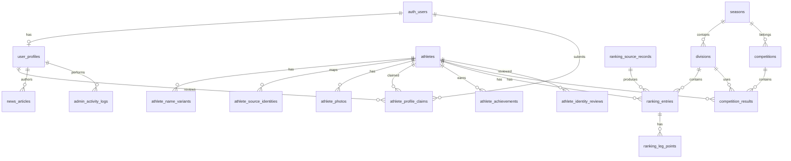

# UPSA Supabase Setup

The SQL migrations in this folder are review drafts and do not run automatically. The member account and public profile pages connect to Supabase only after you configure `supabase/config.js` and apply the reviewed migrations to your project.

## Scope

The prepared architecture covers:

- Supabase Auth identities and application roles
- Member sign-up/sign-in, self-managed public profiles, and embedded public Instagram links
- Athlete profiles and identity-review records
- 2022-2026 ranking seasons, divisions, entries, leg points, and source records
- Future individual competition results
- Events and news
- Athlete achievements and profile claims
- Admin activity logs
- Row Level Security
- Supabase Storage layout

The existing ranking data and ranking-derived athlete profiles remain unchanged. Member account controls are integrated into the Membership page, and the Account header link has been removed.

## Proposed structure

```text
supabase/
  migrations/
    20261119_001_initial_schema.sql
    20261119_002_rls_policies.sql
    20261121_003_member_profiles_and_instagram_reels.sql
    20261121_004_verified_athlete_profile_sync.sql
    20261121_005_member_profile_images_and_nationality.sql
    20261121_006_admin_membership_management.sql
  functions/
    google-membership-sync/
      index.ts
  google-apps-script/
    Code.gs
  SQL_EDITOR_BASE_001_002.sql
  config.js
  client.js
  seed/
    historical-ranking-audit.json
  scripts/
    import-historical-rankings.example.mjs
  README.md
```

`SQL_EDITOR_BASE_001_002.sql` is a convenience copy of migrations 001 and 002 only. It is not the full 001–006 schema; review and test it before using it, and do not run it if either base migration has already been applied.

## Create a Supabase project

1. Create a new Supabase project.
2. Select a region near the intended website users.
3. Configure the project URL and public anon/publishable key in `supabase/config.js`. The anon key is intended for browser use; never use a service-role key or database password there.
4. Never place database passwords or service-role keys in this repository.
5. Enable email/password authentication.
6. Configure a supported local/deployed site URL and email redirect URLs.
7. Review the migration drafts with the database administrator.
8. Review and apply the SQL migration files to a staging project in filename order, including migrations 003 through 006.
9. Insert or verify the initial admin account and role through a controlled admin process.
10. Import the historical ranking source records through the repeatable script or a reviewed SQL/ETL process.
11. Compare imported counts and source hashes with the original JavaScript data.
12. Approve the data before production deployment.
13. Test public, signed-in, private-profile, and other-user requests in staging before production.

## Member accounts and public profiles

The Membership page combines profile editing with the existing membership plans and application flow. Guests see a surfing-themed banner and separate sign-up/sign-in links; membership content is revealed after authentication. The old `account.html` URL redirects to the account section on Membership. Members can add or remove public Instagram Reel/post links; public profiles embed these through Instagram's embed script. Standalone community profiles use the athlete-profile layout and display the member's saved photos, bio, home break, surf club, social links, theme, and Reels. Official rankings and results appear only for a verified athlete link. Videos are not downloaded, copied, or uploaded to this website.

The third migration creates separate `member_profiles` and `member_instagram_reels` tables. New profiles are private by default. Row Level Security allows each signed-in member to edit only their own profile and links. Public visitors can read only profiles marked public and the links attached to those profiles. By itself, this migration does not connect accounts to ranking-derived athlete profiles.

The fourth migration adds profile photo URL fields and verified account-to-athlete links. Members can submit an Athlete ID claim; only an UPSA-reviewed link appears on the public athlete page. The athlete directory and profile pages combine the account's approved public bio, display name, photos, social links, and Instagram embeds with the existing ranking data. The fifth migration adds ISO 3166-1 alpha-2 country/territory codes (plus `XK` for Kosovo) and the public `member-profile-images` Storage bucket. Members can upload JPG, PNG, or WebP profile and cover images up to 5 MB; authenticated writes are restricted to each member's own storage folder. Uploaded image URLs are publicly readable even when the member profile is private, so members should upload only images they are comfortable making public. Rankings, results, and achievements remain sourced from UPSA records and cannot be changed through member accounts. Conflicting or name-only ranking identities must not be linked as `id:<source-id>`.

The sixth migration adds the private membership application inbox and administrator-only review functions. The `admin.html` screen requires a signed-in account whose existing `user_profiles.role` is `admin`. It lists the latest applications and Athlete ID claims, lets admins update application/payment statuses, and approves or rejects Athlete ID claims transactionally. Admin actions are recorded in `admin_activity_logs`. Application payment status is an administrative verification only; the website does not process payments.

Membership registration and renewal remain Google Forms. To sync their responses, deploy the `google-membership-sync` Edge Function and install the provided `Code.gs` in each form's response spreadsheet. The script can backfill existing rows and sync new submissions through the same authenticated endpoint. It uses a shared secret stored only in Supabase Function secrets and Google Apps Script Properties; never place the service-role key in the script or browser. Application responses are private to admins. The sync omits form fields whose names indicate card or bank account numbers, security codes, passwords, PINs, or bank login credentials. Do not collect those details in Google Forms.

### Configure the Google Forms sync

1. Apply migration 006 after migrations 003–005.
2. Install and authenticate the Supabase CLI, then link it to this project:

   ```sh
   supabase link --project-ref ydwxkabaxzpkqawrjppf
   ```

3. Generate a long random secret (at least 32 random bytes). On Windows PowerShell:

   ```powershell
   $bytes = New-Object byte[] 32
   $rng = New-Object System.Security.Cryptography.RNGCryptoServiceProvider
   $rng.GetBytes($bytes)
   $secret = [System.BitConverter]::ToString($bytes).Replace('-', '').ToLowerInvariant()
   $secret
   ```

   Set that same value as the Edge Function secret and the `UPSA_WEBHOOK_SECRET` Script Property. Keep it private and do not commit it.
4. Deploy the function with JWT verification disabled because Google Apps Script does not have a Supabase user JWT. The function independently checks the shared secret on every request:

   ```sh
   supabase secrets set UPSA_FORMS_WEBHOOK_SECRET=YOUR_RANDOM_SECRET
   supabase functions deploy google-membership-sync --no-verify-jwt
   ```

5. In each Google Form, open its linked response spreadsheet. Add the contents of `supabase/google-apps-script/Code.gs` to that spreadsheet's Apps Script project. Restrict spreadsheet and script-editor access to trusted UPSA staff.
6. In Apps Script **Project Settings → Script Properties**, add:
   - `UPSA_SYNC_URL` = `https://ydwxkabaxzpkqawrjppf.supabase.co/functions/v1/google-membership-sync`
   - `UPSA_WEBHOOK_SECRET` = the same random secret set in Supabase
   - `UPSA_FORM_KEY` = a distinct label such as `new-members` or `renewals`
7. Add an installable trigger for `onMembershipFormSubmit`, selecting **From spreadsheet → On form submit**. Run `syncExistingMembershipResponses` once for the active response sheet to backfill existing entries. Retrying is safe; duplicate rows are ignored.
8. Submit a test response and confirm it appears in the Admin screen at `/admin.html`. Do not assume sync is active until this test succeeds for each form.

### Create the first administrator

Create the intended UPSA staff account through the normal account sign-up flow and confirm its email. Then, as the Supabase project owner, run this SQL once in the SQL Editor, replacing the email with that account's address:

```sql
select public.bootstrap_initial_admin('replace-with-admin-email@example.com');
```

Confirm the query returns one user UUID, then sign in at `/admin.html`. This bootstrap function is executable only by the database owner and refuses to run once an active administrator exists. Do not add a role selector to public registration and never put a service-role key or admin password in website code.

Review Athlete ID claims in `/admin.html` after migration 006 is applied and an admin account is configured. Verify the claimant and confirm the Athlete ID maps to one unique `id:<source-id>` profile in `athlete-data.js` before approving. Reject ambiguous IDs or ask for more evidence; do not approve based only on an exact name. The admin review functions update the claim, create the verified link, and write the audit log in one transaction.

Before deploying, review and apply the migrations in order in a staging Supabase project, enable email/password auth, configure the local/deployed site URL and email redirect URLs, and set the project URL and anon/publishable key in `supabase/config.js`. The Membership page explains when configuration is missing. Membership applications and payments remain handled by the existing UPSA registration forms. Serve the site over HTTPS in production.

## Database relationship diagram



`auth.users` remains separate from `public.athletes`. `user_profiles` is the application-level connection from an authenticated account to role and optional athlete identity.

## Core relationships

- One Supabase Auth user has zero or one application profile.
- An application profile may link to one athlete.
- An athlete may have many name variants and source identity mappings.
- A season has many divisions.
- A division belongs to one season.
- A ranking source record represents one original source row.
- One source record has one ranking entry.
- One ranking entry has many leg-point records.
- Competition results are separate from ranking entries and should not be inferred from leg points.
- One athlete may have many achievements and many competition results.
- Claims and identity reviews preserve unresolved or disputed mappings.

## Identity strategy

Source identity matching must preserve the existing frontend rules:

1. A verified source Athlete ID may create a source-identity mapping.
2. Mappings with one source name and no known conflict remain exact-ID candidates.
3. Exact-name matches may be provisional only when both source names normalize to the same name.
4. A source Athlete ID with multiple names in the same season/category remains conflicting and must not auto-merge.
5. Repeated source names within a division and season remain separate source rows or duplicate-name review cases.
6. Name-only rows from 2022-2024 must not be promoted to verified identities without independent review.
7. Manual identity review may create or update an athlete link, but must record reviewer, reason, evidence, and status.

## Storage layout

Use private-by-default objects and public read only for approved assets:

```text
athlete-photos/
  <athlete-uuid>/profile/
  <athlete-uuid>/cover/
events/
  <event-uuid>/
news/
  <article-uuid>/
```

Add file metadata in database tables rather than inferring ownership from filenames. Allow only verified administrator or permitted athlete profile operations to write. Do not copy random surfing stock photography into athlete folders.

Recommended buckets:

| Bucket | Public reads | Write access |
|---|---|---|
| `athlete-photos` | Verified public athlete photos | Admin; permitted linked player for their own profile |
| `member-profile-images` | Public member profile and cover images | Authenticated member in their own user-id folder |
| `event-images` | Published event images | Admin |
| `news-images` | Published news images | Admin |

Every upload should have a database record. Use size limits and MIME allowlists, such as JPEG, PNG, and WebP, before enabling public buckets. Add malware and moderation review for player uploads. Store original and optimized image versions only when the CDN/storage workflow requires them.

## Administrator assignment

Do not add public registration fields for role selection.

The initial administrator must be assigned through the Supabase SQL Editor or another service-role-only administrative process after confirming the Auth identity belongs to UPSA. The profile trigger creates every new Auth identity with `role = 'player'`.

An existing verified administrator may later assign another admin through a secure server-only function or SQL process. Never create an admin from a browser RPC that accepts a public user-selected role.

Recommended bootstrap:

1. Create the UPSA account through Supabase Auth.
2. Confirm the email and promote only that account using `bootstrap_initial_admin` in the SQL Editor.
3. Test public, player, and admin requests in staging.
4. Keep project-owner access limited to trusted administrators.

## File-by-file implementation plan

| File | Future role |
|---|---|
| `rankings-data.js` | Remains the public source until backend integration is approved |
| `athlete-data.js` | Keeps the source ranking identities and profile keys used by public pages |
| `athletes.js` | Renders the ranking directory and overlays approved public names and photos |
| `athlete-profile.js` | Renders source rankings with approved member profile details and social links |
| `rankings.js` | Later fetch ranking entries while preserving table rendering and pagination |
| `events.html` / `script.js` | Later load published events behind the existing filter interface |
| `news.js` / `news.html` / `news-story.html` | Later migrate to published articles while preserving slugs and article URLs |
| `membership/membership.html` / `account.js` | Membership plans and profile editing, shown after authentication |
| `membership/signup.html` / `membership/signin.html` / `membership-auth.js` | Separate account creation, sign-in, password reset, and redirect handling |
| `admin.html` / `admin.js` | Admin-only membership inbox and athlete-claim review |
| `supabase/functions/google-membership-sync/index.ts` | Secret-protected Google Forms response ingestion |
| `supabase/google-apps-script/Code.gs` | New-response sync and safe backfill from Forms response sheets |
| `countries.js` | Country/territory labels and flag emoji for member profiles |
| `account.html` | Redirects to the account section of the Membership page |
| `member-profile.html` / `member-profile.js` | Public member profiles; approved athlete links redirect to the official athlete profile |
| `instagram-embeds.js` | Shared Instagram embed loader for public member and athlete profiles |
| `supabase/client.js` / `supabase/config.js` | Browser Supabase client and public project configuration |
| `supabase/migrations/` | Apply only after database review and staging validation |
| `supabase/seed/historical-ranking-audit.json` | Reference and validation seed inventory |
| `supabase/scripts/` | Repeatable source parser and migration validation |

## Later frontend integration

Keep current JavaScript data sources until backend integration is explicitly approved.

After approval:

1. Add a Supabase client only to pages selected for migration.
2. Create read-only repository functions for rankings and athlete profiles.
3. Keep the existing profile URL format working during transition.
4. Prefer server-verified or view-based public reads.
5. Feature a database source behind the existing frontend interfaces.
6. Preserve the current identity safeguards and name-only profile behavior.
7. Keep no service-role key in browser code.
